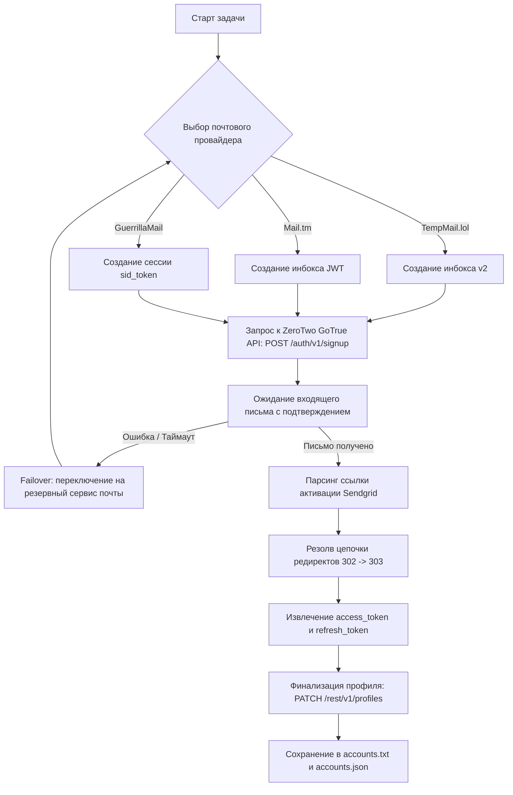

# ZeroTwo Automation & API Research Toolkit

[](https://www.python.org/downloads/)
[](https://opensource.org/licenses/MIT)
[](https://docs.python.org/3/library/asyncio.html)
[](https://github.com/)

> ⚠️ **DISCLAIMER / ДИСКЛЕЙМЕР**
>
> Данный репозиторий создан **исключительно в образовательных, исследовательских целях и для демонстрации механизмов сетевого взаимодействия** (Network Protocol Analysis, Reverse Engineering & Automation Research). 
> Проект демонстрирует реализацию взаимодействия клиентских приложений с современными API аутентификации (Supabase GoTrue), работу с протоколами временных почтовых сервисов (REST APIs) и многопоточную обработку сетевых соединений в Python.
> 
> Автор не несет ответственности за любое использование представленного программного кода, нарушающее пользовательские соглашения сторонних сервисов (ToS) или применимое законодательство. Все товарные знаки и имена сервисов принадлежат их законным правообладателям.

---

## 📌 О платформе ZeroTwo

**ZeroTwo Automation Toolkit** — легковесный, высокоскоростной асинхронный инструмент на Python для автоматизации регистрации и интеграции с API мультимодального AI-хаба [ZeroTwo.ai](https://zerotwo.ai).

Платформа ZeroTwo агрегирует доступ к передовым текстовым и генеративным визуальным моделям:

### 🧠 Текстовые LLM модели
* **GPT 6 Luna** — флагманское мышление, глубокий контекст и аналитика
* **DeepSeek V4.1 Flash** — сверхбыстрая генерация кода и решение технически сложных задач
* **Muse Spark 1.3 (c)** — креативная обработка текста, нарративы и копирайтинг
* **GLM 5.3 Flash** — минимальная задержка инференса и работа в реальном времени
* **MiniMax M3** — удержание длинных диалоговых цепочек и контекстов

### 🎨 Генерация изображений и визуала
* **Bytedance**: Seedream v5 Lite, Seedream 4.5, Seedream 5.0 Pro
* **FAL**: Flux.1 Dev, Flux Pro, Flux Pro 2
* **Google**: Nano Banana, Nano Banana Pro, Nano Banana 2
* **Ideogram**: Ideogram 2.0 (типографика и реалистичный рендер)
* **OpenAI**: GPT Image 2.5 Flare, GPT Image 2.5 Sunburst, GPT Image 2, GPT Image 1.5, GPT Image 1 / Mini
* **Qwen**: Qwen, Qwen Image 2, Qwen Image 2 Pro, Qwen Image 3
* **Recraft**: Recraft V4.1 (векторная и растровая графика)
* **xAI**: Grok Imagine, Grok Imagine Image 2.0
* **Z.AI**: Z-Image Turbo

В отличие от решений на базе браузерных эмуляторов (Playwright / Puppeteer / Selenium), инструмент взаимодействует с протоколами на нативном уровне HTTP/JSON, потребляя минимум системных ресурсов и обеспечивая выполнение одного цикла регистрации за **~3–5 секунд**.

---

## ✨ Ключевые возможности

* **Нативная работа с GoTrue API**: Взаимодействие напрямую с бэкендом аутентификации без необходимости рендеринга тяжелого веб-интерфейса.
* **Интеллектуальный пул временных почт (Multi-TempMail Failover)**:
  * Встроена поддержка 3 независимых сервисов временных почт:
    1. **TempMail.lol (v2 REST API)** — быстрая генерация и чтение сообщений, домены `*.inovel26.com`, `*.imagesthere.com` и др.
    2. **Mail.tm** — стабильный сервис с JWT-авторизацией.
    3. **GuerrillaMail** — проверенный классический сервис.
  * Режим `auto` автоматически определяет задержки или недоступность доменов и переключается на резервный сервис без прерывания задач.
  * Автоматическое декодирование Quoted-Printable для надежного извлечения токенов из писем.
* **Универсальный менеджер прокси**:
  * Поддерживаются протоколы: `HTTP`, `HTTPS`, `SOCKS4`, `SOCKS5` (с авторизацией `user:pass` и без нее).
  * Автоматический парсинг любых популярных форматов строк (`protocol://...`, `host:port:user:pass`, `host:port`).
  * Режимы ротации: по кругу (`round_robin`) или случайно (`random`).
* **Активация и онбординг**:
  * Автоматический переход по цепочке верификационных редиректов (SendGrid 302 -> Verify 303).
  * Мгновенное извлечение JWT-сессии (`access_token`, `refresh_token`).
  * Автоматическая инициализация профиля пользователя (`onboarding_completed: true`).
* **Интерактивное консольное меню**:
  * Удобный терминальный интерфейс для настройки параметров в реальном времени.
  * Встроенный инструмент открытия сессий в браузере в 1 клик ([open_account.py](file:///d:/AutoregZeroTwo/open_account.py)).
  * Утилита чтения входящей почты для получения свежих Magic Links ([check_mail.py](file:///d:/AutoregZeroTwo/check_mail.py)).

---

## 🏗 Архитектура решения



---

## 📁 Структура репозитория

```text
├── main.py              # Интерактивное меню и точка входа в программу
├── autoreg.py           # Асинхронный движок управления потоками и очередями
├── zerotwo_client.py    # Клиент взаимодействия с GoTrue и REST API ZeroTwo
├── tempmail.py          # Мульти-провайдер временной почты с авто-переключением
├── proxy_manager.py     # Парсер и ротатор прокси всех типов (HTTP/SOCKS)
├── open_account.py      # Утилита мгновенного открытия аккаунта в браузере
├── check_mail.py        # Утилита чтения писем и извлечения ссылок входа
├── config.json          # Файл глобальных настроек
├── proxies.txt          # Файл со списком прокси
├── requirements.txt     # Зависимости Python
├── accounts.txt         # Сохраненные аккаунты (наглядный текстовый вид)
├── accounts.json        # База аккаунтов со всеми токенами и метаданными
├── LICENSE              # Лицензия MIT
└── README.md            # Документация проекта
```

---

## 🚀 Установка

1. **Клонируйте репозиторий:**
   ```bash
   git clone https://github.com/greenyarik0505-jpg/zerotwo-automation-toolkit.git
   cd zerotwo-automation-toolkit
   ```

2. **Создайте и активируйте виртуальное окружение:**
   ```bash
   python -m venv .venv
   # Windows:
   .venv\Scripts\activate
   # Linux / macOS:
   source .venv/bin/activate
   ```

3. **Установите зависимости:**
   ```bash
   pip install -r requirements.txt
   ```

---

## ⚙️ Настройка (`config.json`)

```json
{
  "threads": 3,
  "target_count": 5,
  "use_proxies": false,
  "proxy_file": "proxies.txt",
  "proxy_type_default": "http",
  "proxy_rotation": "round_robin",
  "tempmail_provider": "auto",
  "request_timeout": 30,
  "email_poll_timeout": 45,
  "email_poll_interval": 2,
  "accounts_file": "accounts.txt",
  "accounts_json_file": "accounts.json",
  "complete_onboarding": true,
  "default_password": null
}
```

| Параметр | Описание |
| :--- | :--- |
| `threads` | Количество параллельных асинхронных задач. |
| `target_count` | Необходимое число аккаунтов для создания. |
| `use_proxies` | `true` — использовать прокси из `proxies.txt`, `false` — работать напрямую. |
| `tempmail_provider` | `auto` (умный пул с failover), либо жестко: `tempmail_lol`, `mail_tm`, `guerrillamail`. |
| `complete_onboarding` | Автоматически закрывать опрос онбординга после регистрации. |
| `default_password` | Фиксированный пароль или `null` для генерации уникального сложного пароля. |

---

## 🖥 Использование

### 1. Интерактивный режим (Меню)
Запустите команду без аргументов:
```bash
python main.py
```
Откроется главное меню, в котором можно настроить параметры, запустить генерацию, открыть аккаунт в браузере или проверить почту.

### 2. Пакетный запуск через аргументы командной строки
```bash
# Тестовая регистрация 1 аккаунта с подробным логом:
python main.py --test

# Регистрация 10 аккаунтов в 3 потока напрямую:
python main.py -c 10 -t 3 --no-proxy

# Регистрация 50 аккаунтов через прокси:
python main.py -c 50 -t 10 --proxies

# Явный выбор почтового провайдера:
python main.py -c 10 -t 3 -m tempmail_lol
```

### 3. Быстрый вход в созданный аккаунт в браузере
```bash
python open_account.py
```
Скрипт покажет список ваших аккаунтов, сформирует готовую ссылку и откроет выбранный аккаунт в браузере.

---

## 💾 Формат выходных данных

### `accounts.txt`:
```text
=========================================
АККАУНТ 1
=========================================
Почта (твой главный логин): zt_user123@domain.com
Пароль (Не работает етот метод входа): Z2_P@ssw0rd!
Ссилка для входа: https://app.zerotwo.ai/auth/callback#access_token=...&refresh_token=...&token_type=bearer&type=signup
```

### `accounts.json`:
```json
[
  {
    "email": "zt_user123@domain.com",
    "password": "Z2_P@ssw0rd!",
    "login_url": "https://app.zerotwo.ai/auth/callback#access_token=...&refresh_token=...&token_type=bearer&type=signup",
    "login_note": "Вход по паролю на сайте zerotwo.ai недоступен. Для входа перейдите по ссылке login_url.",
    "user_id": "388c2208-xxxx-xxxx-xxxx-xxxxxxxxxxxx",
    "access_token": "eyJhbGciOi...",
    "refresh_token": "6zwohy6triok",
    "tempmail_provider": "tempmail_lol",
    "created_at": "2026-09-28T21:30:00.000000+00:00",
    "proxy_used": null
  }
]
```

---

## 📜 Лицензия

Проект распространяется под свободной лицензией **MIT License**. Подробнее см. в файле [LICENSE](file:///d:/AutoregZeroTwo/LICENSE).
